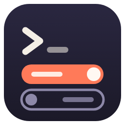
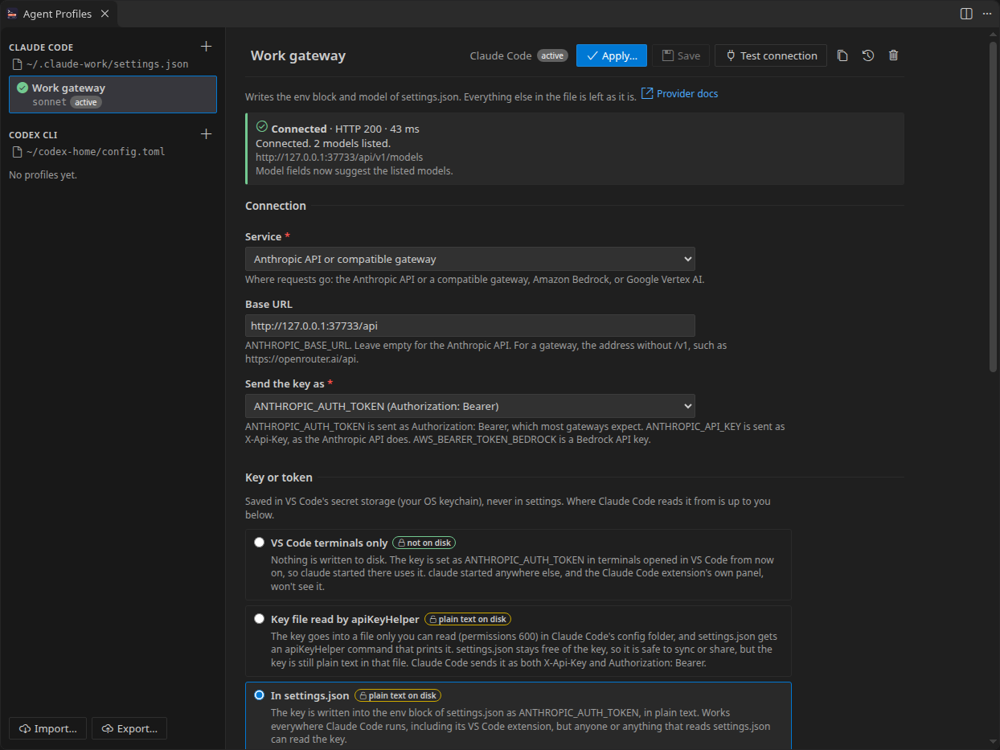
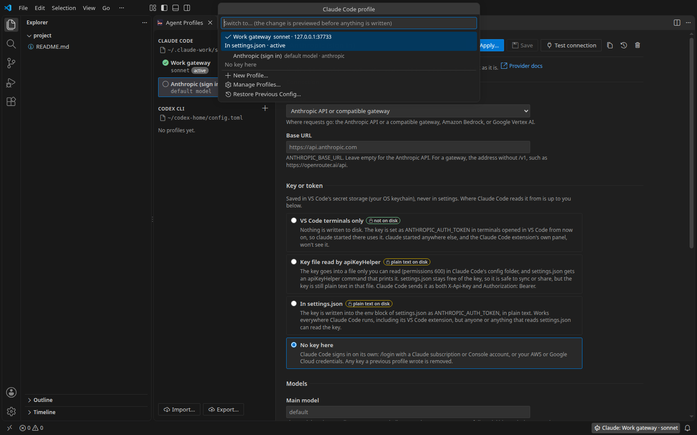
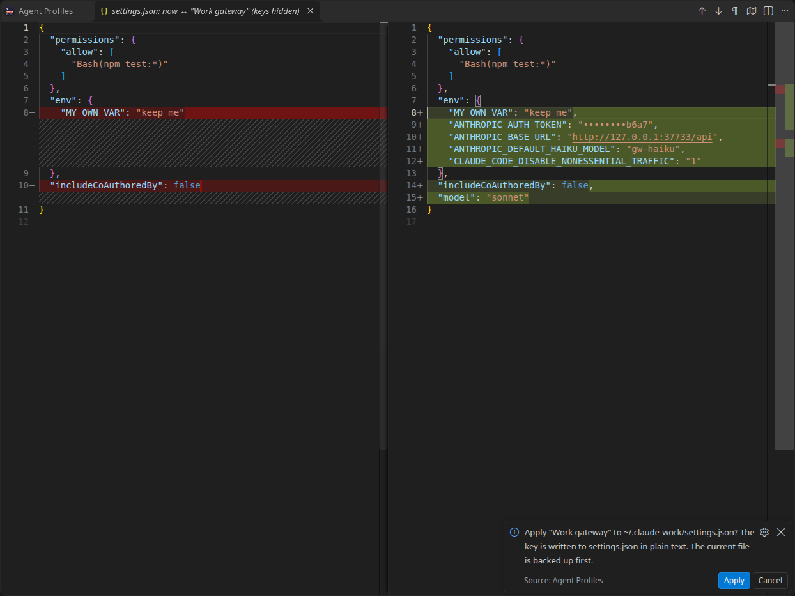

<h1 align="center">
  <br>
  Agent Profiles
</h1>

<p align="center">
  Switch the provider, gateway, key and models that Claude Code and Codex CLI use, from a form and the status bar.
</p>

<p align="center">
  <a href="https://github.com/heyliamme/agent-profiles/blob/main/CHANGELOG.md">Changelog</a> ·
  <a href="https://github.com/heyliamme/agent-profiles/blob/main/CONTRIBUTING.md">Contributing</a>
</p>



Claude Code and Codex CLI each read their provider settings from a config file:
`~/.claude/settings.json` for one, `~/.codex/config.toml` for the other. Moving between
the Anthropic API, a company gateway, OpenRouter, Bedrock or a local model means
editing environment variables and TOML tables by hand, remembering key names such as
`ANTHROPIC_DEFAULT_HAIKU_MODEL` or `wire_api`, and hoping nothing else in the file got
lost.

Agent Profiles keeps each setup as a named profile and writes it for you:

- **A form instead of config keys.** Each field says which key it writes and what it does.
  Presets fill in the common setups; every field stays editable.
- **One switch.** The status bar shows each agent's active profile and model. Click it to
  switch.
- **Keys stay out of settings.** They are kept in VS Code's secret storage (your
  operating system's keychain). You choose where the agent reads them from, and the form
  says plainly when that means plain text on disk.
- **Nothing is written blind.** Every change is shown as a diff with keys hidden, written
  only when you click Apply, and the previous file is backed up first.
- **Your other settings are left alone.** Permissions, hooks, MCP servers, comments and
  formatting stay as they were. Only the keys a profile manages change.

Agent Profiles is not affiliated with or endorsed by Anthropic or OpenAI. Claude Code and
Codex are their respective owners' products.

## Install

From the [Visual Studio Marketplace](https://marketplace.visualstudio.com/items?itemName=heyliam.agent-profiles),
from [Open VSX](https://open-vsx.org/extension/heyliam/agent-profiles) (VSCodium, Cursor
and other editors), or from a terminal:

```bash
code --install-extension heyliam.agent-profiles
```

## Getting started

1. Run **Agent Profiles: Open Profiles** from the Command Palette.
2. Click **+** next to Claude Code or Codex CLI and pick a preset, or **Import current
   config** to start from the file as it is now.
3. Fill in the address and the key, and click **Test connection** to check them.
4. Click **Apply…**. A diff of the config file opens, keys hidden; click **Apply** in the
   notification to write it.

From then on, the status bar shows the active profile. Click it to switch: every switch is
previewed the same way.



## What gets written where

The agent definitions are data files ([`src/core/agents`](src/core/agents)). Each field
names the key it writes, so the form's help text and this table come from the same place.

### Claude Code

File: `settings.json` in `$CLAUDE_CONFIG_DIR` if that is set, otherwise
`~/.claude/settings.json`. A profile can instead be applied to the open project's
`.claude/settings.local.json`, which wins over your user settings in that folder. When a
profile writes its key there in plain text, Agent Profiles makes sure Git ignores the file:
if nothing ignores it yet, it is added to the clone's `.git/info/exclude` (the prompt says
so), and a file Git already tracks is refused.

| Field | Key |
| --- | --- |
| Base URL | `env.ANTHROPIC_BASE_URL` |
| Main model | `model` |
| Opus / Sonnet / Haiku models | `env.ANTHROPIC_DEFAULT_OPUS_MODEL`, `env.ANTHROPIC_DEFAULT_SONNET_MODEL`, `env.ANTHROPIC_DEFAULT_HAIKU_MODEL` |
| Subagent model | `env.CLAUDE_CODE_SUBAGENT_MODEL` |
| Amazon Bedrock | `env.CLAUDE_CODE_USE_BEDROCK=1`, `env.AWS_REGION`, `env.AWS_PROFILE`, `env.ANTHROPIC_BEDROCK_BASE_URL` |
| Google Vertex AI | `env.CLAUDE_CODE_USE_VERTEX=1`, `env.CLOUD_ML_REGION`, `env.ANTHROPIC_VERTEX_PROJECT_ID`, `env.ANTHROPIC_VERTEX_BASE_URL` |
| Extra request headers | `env.ANTHROPIC_CUSTOM_HEADERS` |
| Request timeout, max output tokens | `env.API_TIMEOUT_MS`, `env.CLAUDE_CODE_MAX_OUTPUT_TOKENS` |
| Turn off non-essential traffic | `env.CLAUDE_CODE_DISABLE_NONESSENTIAL_TRAFFIC=1` |
| Other environment variables | `env.<NAME>`, one per line |
| The key | see [Keys](#keys): `env.ANTHROPIC_AUTH_TOKEN`, `env.ANTHROPIC_API_KEY`, `env.AWS_BEARER_TOKEN_BEDROCK` or `apiKeyHelper` |

Presets: Anthropic (sign in), Anthropic API key, OpenRouter, Anthropic-compatible gateway,
DeepSeek, Kimi (Moonshot), Z.ai (GLM), Amazon Bedrock and Google Vertex AI.

Sources: [settings](https://code.claude.com/docs/en/settings),
[environment variables](https://code.claude.com/docs/en/env-vars),
[LLM gateways](https://code.claude.com/docs/en/llm-gateway),
[Amazon Bedrock](https://code.claude.com/docs/en/amazon-bedrock),
[Google Vertex AI](https://code.claude.com/docs/en/google-vertex-ai).

### Codex CLI

File: `config.toml` in `$CODEX_HOME` if that is set, otherwise `~/.codex/config.toml`.
Codex ignores providers in a project's `.codex/config.toml`, so Codex profiles always
apply to your user config.

| Field | Key |
| --- | --- |
| Provider id | `model_provider` (`openai`, `ollama` and `lmstudio` are built into Codex; any other id gets its own table) |
| Display name, base URL, wire API | `[model_providers.<id>]` `name`, `base_url`, `wire_api` |
| Key variable | `[model_providers.<id>]` `env_key` |
| Model | `model` |
| Reasoning effort, reasoning summary | `model_reasoning_effort`, `model_reasoning_summary` |
| Context window | `model_context_window` |
| Query parameters, extra headers | `[model_providers.<id>]` `query_params`, `http_headers` |
| Retries, stream idle timeout | `[model_providers.<id>]` `request_max_retries`, `stream_max_retries`, `stream_idle_timeout_ms` |
| The key | see [Keys](#keys): an environment variable named by `env_key`, `$CODEX_HOME/.env`, or `experimental_bearer_token` |

Presets: OpenAI (sign in), OpenAI API key, OpenRouter, Azure OpenAI, OpenAI-compatible
gateway and Ollama (local).

Sources: [config.md](https://github.com/openai/codex/blob/main/docs/config.md),
[configuration reference](https://learn.chatgpt.com/docs/config-file/config-reference),
[advanced configuration](https://learn.chatgpt.com/docs/config-file/config-advanced).

### What "only the keys a profile manages" means

Every key in the tables above is managed: applying a profile sets it to the profile's
value or removes it if the profile leaves it empty, so nothing carries over from the
previous profile. Keys the previous apply added under "Other environment variables" and
the previous provider's table are taken back too. Everything else is never touched:
permissions, hooks, MCP servers, `approval_policy`, other providers you defined yourself,
comments, key order and indentation. A file with a syntax error is refused, not replaced.

## Keys

Keys are kept in VS Code's secret storage, never in VS Code settings or the extension's
state. The form shows a saved key as dots and its last four characters; the eye button
shows it on request. Keys are never written to logs or notifications, and exported
profiles don't include them.

The agents themselves can't read VS Code's secret storage, so each profile says how the
key reaches the agent. Each option has a cost:

| Option | Claude Code | Codex CLI | On disk |
| --- | --- | --- | --- |
| **VS Code terminals only** (default for presets) | The key is set as `ANTHROPIC_AUTH_TOKEN` (or the variable you choose) in terminals opened in VS Code | The key is set as the `env_key` variable in terminals opened in VS Code; `config.toml` only names the variable | Nothing |
| **Key file read by `apiKeyHelper`** (Claude Code) | The key goes into a file readable only by you (`agent-profiles/user.key` in Claude Code's config folder, permissions 600); `settings.json` gets an `apiKeyHelper` command that prints it | | Plain text, in its own file |
| **In Codex's `.env` file** (Codex) | | `NAME=key` in `$CODEX_HOME/.env` (permissions 600), which Codex loads at startup | Plain text, in its own file |
| **In the config file** | `env.ANTHROPIC_AUTH_TOKEN` etc. in `settings.json` | `experimental_bearer_token` in `config.toml` | Plain text, in the config |
| **No key here** | `/login`, or your AWS / Google Cloud credentials | `codex login`, a local server with no key, or a key your own shell exports: a custom provider's `env_key` is still written | Nothing |

Which to choose:

- **VS Code terminals only** writes no key anywhere. But only `claude` or `codex` started in
  a VS Code terminal opened after the switch sees it. Not a terminal outside VS Code, and
  not the agents' own VS Code extensions, which don't run in a terminal. VS Code marks
  terminals that need restarting. Like any environment variable in a terminal, the key is
  visible to programs you run there. If you set VS Code's log level to **Trace**, its
  terminal host writes each new terminal's environment, key included, to its log file.
- **Key file** and **.env** work wherever the agent runs, including its VS Code extension,
  and keep the key out of the config file, so that file can be synced or shared. The key
  is still plain text on disk, protected only by file permissions. Codex reading
  `$CODEX_HOME/.env` comes from its source code rather than its documentation.
- **In the config file** works everywhere and is what most guides show. Anyone or anything
  that can read the config file can read the key. The form marks it **plain text on disk**,
  and the Apply prompt says so again.

Switching to another profile removes the key the previous one wrote: the config entry, the
key file, or its line in `.env`. A key you put in `settings.json` by hand is removed too
when you switch to a profile that keeps its key elsewhere, because it would otherwise win
over the new one. Restoring a backup does the same for the backup's state: the key file
or `.env` line of the apply being undone is removed, and the one the restored config uses
is written again from secret storage. The restore prompt lists both.

A header that carries a credential (`Authorization`, `x-api-key`, `Bearer …`) is refused
in Claude Code's **Extra request headers** and Codex's **Extra headers**, left out of
**Import current config** and of exports, and masked in previews: keys go in the key field.

The Claude Code VS Code extension runs its own
login check before starting; with a third-party gateway you may need its
`claudeCode.disableLoginPrompt` setting.

## Safety



- **Preview.** Every write, a switch from the status bar included, opens a diff of the
  config file first, with keys masked on both sides. Nothing is written until you click
  **Apply**. If a key file or `.env` changes too, the prompt says so.
- **Backups.** Before every write, the current file is copied to the extension's own
  storage (readable only by you), keeping the last 10 per file (`agentProfiles.backups`).
  **Agent Profiles: Restore Previous Config…** lists them, previews the restore as a diff,
  and backs up the current file before restoring. Backups are copies of your config
  files, so if a file held a key in plain text, its backup does too.
- **Atomic writes.** Files are written to a temporary file next to the target, flushed,
  and renamed over it. Permissions are kept. A symlinked user config (dotfiles) is written
  through the link, and the link stays. Project files are never written through a link,
  since the repository decides where those point. If one of several files fails to write,
  the ones already written are put back, so a config is never left with another
  profile's key.
- **External edits.** If the file changes while the preview is open, nothing is written
  and you can preview again. If it changed since the form was opened, you're told before
  the preview. A value a profile manages that was changed outside Agent Profiles since
  the last apply gets a warning in the status bar. Other edits to the file, such as
  Codex trusting a project, don't.
- **Test connection** sends one request, only when you click it: the provider's models
  list, or a one-token request if there is none. Some models lists answer without a key
  (OpenRouter's does), so the list is asked for once more without it: if it still
  answers, the one-token request checks the key, or, with no model set, the result says
  the key was not checked. The key goes only to the address you configured. Redirects
  are not followed, and at most 200 KB of an answer is read. The result shows the status,
  the latency and the models found, which the model fields then suggest. There is no other
  network access and no telemetry.

## Commands

| Command | |
| --- | --- |
| **Agent Profiles: Open Profiles** | The profiles editor |
| **Agent Profiles: Switch Profile…** | Quick pick of an agent's profiles (also from the status bar) |
| **Agent Profiles: New Profile…** | From a preset, blank, or the current config |
| **Agent Profiles: Import Current Config as Profile** | Reads `settings.json` / `config.toml` (and Codex's `.env`) into a profile; offers to keep a key it finds in secret storage, without changing the file |
| **Agent Profiles: Test Connection…** | Tests a saved profile |
| **Agent Profiles: Restore Previous Config…** | Puts back a backup, after a diff |
| **Agent Profiles: Export Profiles (Without Keys)…** | Profiles as JSON, to move to another machine |
| **Agent Profiles: Import Profiles…** | Reads such a file; enter the keys again afterwards |
| **Agent Profiles: Set Workspace Default Profile…** | The profile to suggest when this workspace opens |
| **Agent Profiles: Apply Workspace Default Profile** | Applies the workspace's defaults (with a preview) |
| **Agent Profiles: Open Agent Config File…** | Opens `settings.json` or `config.toml` |

A workspace default is only a suggestion. When the workspace opens with a different
profile active, you're asked whether to switch. It is never applied silently. Defaults
are kept in VS Code's workspace state on your machine, not in the repository.

## Settings

| Setting | Default | |
| --- | --- | --- |
| `agentProfiles.statusBar` | `auto` | Show each agent's active profile: `auto` (agents with profiles), `always`, `never` |
| `agentProfiles.backups` | `10` | Copies kept per config file |
| `agentProfiles.testTimeoutSeconds` | `15` | How long Test connection waits |

All three are application settings, so a workspace's `.vscode/settings.json` can't change
them.

## Restricted Mode, Remote and WSL

- **Restricted Mode.** Profiles still apply to your user config, which nothing in the
  workspace can influence. Writing the project's `.claude/settings.local.json` needs a
  trusted workspace.
- **Virtual workspaces.** Project settings need a folder on disk; in a virtual workspace
  (such as Remote Repositories), profiles apply to your user config only.
- **Remote, WSL and dev containers.** The extension runs where the workspace is (the remote
  side), so it reads and writes the agents' files on the machine where `claude` and
  `codex` run. VS Code's secret storage is kept by the local VS Code client, and keys are
  handed to the remote side when applied.
- **Environment variables.** `CLAUDE_CONFIG_DIR` and `CODEX_HOME` are read from VS Code's
  environment. If you set them only in a shell profile and start VS Code from a desktop
  launcher, VS Code may not see them. Start it from that shell, or check the path shown
  under each agent in the editor.

## Limitations

- Claude Code and Codex CLI only, for now. MCP servers, permissions and hooks are not
  managed.
- Codex's built-in `amazon-bedrock` providers and Codex's `auth` command-based tokens are
  not configured by the form. Codex `[profiles]` (`--profile`) are left as they are.
- Test connection can't check Bedrock, Vertex AI or signed-in accounts (`/login`,
  `codex login`): their credentials aren't held by this extension.
- "VS Code terminals only" covers integrated terminals opened after the switch, not other
  terminals or the agents' own VS Code extensions.
- Model ids aren't checked against the provider, beyond the list Test connection shows.

## Contributing

See [CONTRIBUTING.md](CONTRIBUTING.md). Adding an agent starts with a data file in
`src/core/agents`.

## License

[MIT](LICENSE). Third-party notices: [ThirdPartyNotices.txt](ThirdPartyNotices.txt).
